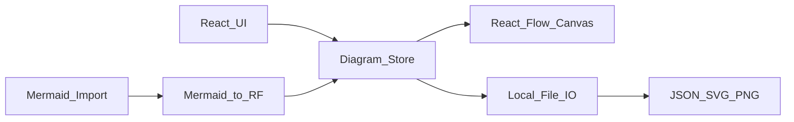

# Plan: Code Sketch

## Keputusan yang dikunci

- **Platform:** web app (SPA)
- **Stack:** Vite + React + TypeScript + Tailwind
- **Canvas:** `@xyflow/react` (React Flow) — node/edge drag-drop, zoom/pan, connections
- **State:** Zustand (atau React Flow + thin store) untuk document model
- **Mermaid:** one-way import (paste/upload syntax → nodes di canvas); bukan sync 2-arah
- **Persistence:** file lokal saja (save/load JSON proyek; export SVG/PNG)
- **Out of scope MVP:** auth, cloud sync, kolaborasi realtime, plugin ecosystem, desktop shell

## Tujuan

Code Sketch adalah editor diagram visual untuk developer, system analyst, dan engineer. Mirip draw.io untuk canvas, plus jalan pintas dari syntax Mermaid ke kanvas yang bisa diedit.

## Requirement

### Canvas & editing

- Drag shapes dari palette ke canvas; pindah, resize, select multi
- Connect nodes dengan edges (orthogonal/bezier sesuai tipe diagram)
- Zoom, pan, undo/redo dasar
- Delete, duplicate, align sederhana

### Diagram types (palette per mode)

- **Flowchart** — process, decision, start/end, connectors
- **Architecture / landscape** — box, service, database, cloud, group/container
- **ERD** — entity, attribute rows, relationship cardinality labels
- **UML** — class, interface, association/inheritance (subset praktis, bukan full UML suite)

### Mermaid import

- Textarea / modal: paste Mermaid source, atau upload `.mmd`/`.md` snippet
- Parse dengan Mermaid; map graph ke React Flow nodes/edges
- Supported first: `flowchart` / `graph`, `erDiagram`, subset `classDiagram`, `C4`/`architecture` jika feasible — fallback graceful jika syntax tidak didukung
- Setelah import, hasil jadi objek canvas biasa (bisa diedit visual); source Mermaid tidak di-sync kembali

### Local files

- **Save project** → download `.codesketch.json` (nodes, edges, viewport, meta)
- **Open project** → file picker load JSON
- **Export** → SVG dan PNG dari viewport
- Autosave ke `localStorage` sebagai safety net (bukan sumber kebenaran utama)

### UX / copy

- Semua UI copy dalam bahasa Inggris
- Layout: left palette, center canvas, right inspector (properties) — minimal chrome

## Architecture (MVP)

- **Document model:** `{ version, diagramType, nodes, edges, viewport }`
- **Mermaid bridge:** modul terpisah `mermaidToFlow()` — isolasi kompleksitas parsing

## Scope

### In scope (v1)

- Scaffold app + canvas + 4 palette modes
- Mermaid paste/import one-way (flowchart + ERD prioritas; class/arch best-effort)
- Save/open JSON, export SVG/PNG, localStorage draft
- Basic inspector (label, color, edge type)

### Out of scope

- Bidirectional Mermaid sync
- Collaboration, accounts, cloud
- Full UML coverage, custom shape designer
- Mobile-first / touch polish

## Delivery slices

1. **Scaffold** — Vite React TS Tailwind, base layout shell
2. **Canvas core** — React Flow, pan/zoom, select, connect, undo/redo
3. **Palettes** — flowchart lalu architecture, ERD, UML class subset
4. **Inspector + export** — properties panel, SVG/PNG
5. **Local project I/O** — JSON save/open + localStorage draft
6. **Mermaid import** — paste modal, converter, error messaging
7. **Polish** — empty states, keyboard shortcuts dasar, regression pass

## Questions

Terselesaikan:

- Platform → web app
- MVP fokus → canvas drag-drop + Mermaid import/paste
- Persistence → file lokal dulu

## Notes

- Gunakan bahasa Inggris untuk copywriting
- Sebisa mungkin hindari overengineering yang terlalu kompleks
- Validasi perubahan, jangan sampai ada regresi antar slice
